<div align="center">

# LabelFlow

**Label data with a team and an LLM, then measure how much you can trust the labels.**

A data annotation platform with LLM pre-labeling, race-safe task assignment and annotation quality analytics.


[Screenshots](#screenshots) · [Quick start](#quick-start-docker) · [Results](#results) · [Architecture](docs/ARCHITECTURE.md) · [Run guide](docs/RUN_GUIDE.md) · [Build story](docs/DEVELOPMENT_JOURNEY.md)

</div>

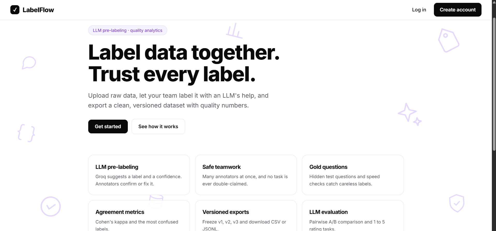

<!-- Add the demo video link or a GIF of the labeling flow here once it is recorded. -->

## At a glance

- **What it is:** a miniature Label Studio / Argilla. A team uploads data, many annotators label it at once, an LLM pre-labels it, and the system exports a clean, versioned dataset.
- **What makes it more than a form:** it measures label quality. Cohen's kappa, hidden gold questions, speed checks, per-annotator scores, and the share of AI suggestions people accept.
- **Engineering highlights:**
  - **Race-safe task claiming** with row locks and database constraints, so no task is double-claimed.
  - **Background LLM pre-labeling** through a Redis queue and an RQ worker, with JSON output validation and retries.
  - **Two LLM evaluation formats** (pairwise A/B and 1 to 5 rating) that reuse the same review, export and agreement code.
  - **One command to run everything:** `docker compose up`.
- **Status:** working end to end. The multi-annotator study with real annotators is in progress, see [Results](#results).

## Contents

[Why](#why-this-project-exists) · [What it does](#what-it-does) · [Screenshots](#screenshots) · [Features](#features) · [How it works](#how-it-works) · [Quick start](#quick-start-docker) · [CSV formats](#csv-formats) · [Results](#results) · [Structure](#project-structure) · [Limitations](#known-limitations) · [Roadmap](#roadmap)

## Why this project exists

Every model learns from labeled examples, and noisy labels quietly cap how good a model can get. Annotation is a team problem: many people, many opinions, and no easy way to tell whose labels to trust.

I built LabelFlow to learn the backend side of ML work: concurrent database access, background jobs, LLM integration, and the statistics of annotator agreement.

## What it does

1. An **admin** creates a project (labels, guidelines, annotators per item) and uploads a CSV. Each row becomes a task.
2. A background worker sends every task to an **LLM (Groq)**, which returns a label and a confidence score. These are stored apart from human labels.
3. **Annotators** label one item at a time with keyboard shortcuts. Each item goes to 2 or 3 different people, and nobody gets the same task twice.
4. If annotators agree, the label is final. If they disagree, a **reviewer** decides, and that decision is final.
5. The platform measures quality: **Cohen's kappa**, AI acceptance rate, **gold questions**, speed checks and annotator scores.
6. Final labels are exported as CSV or JSONL, or frozen as **dataset versions** (v1, v2, v3).

## Screenshots

| Labeling with AI suggestion | Pairwise A/B evaluation |
|---|---|
| 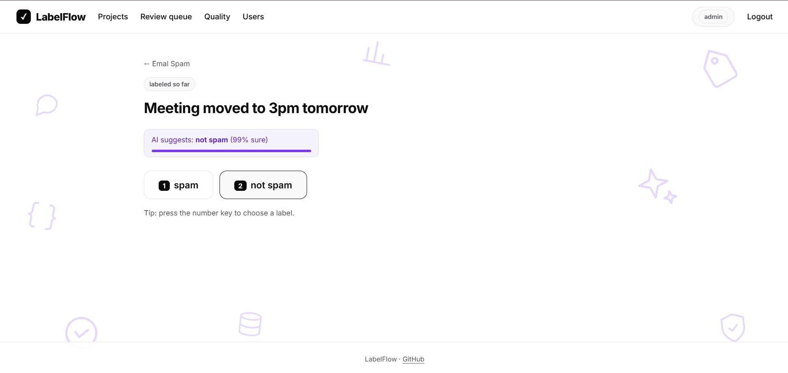 | 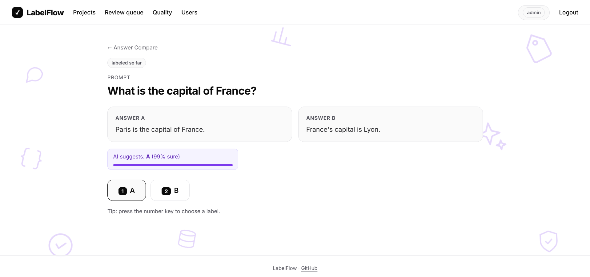 |

| Project overview | Dashboard |
|---|---|
| 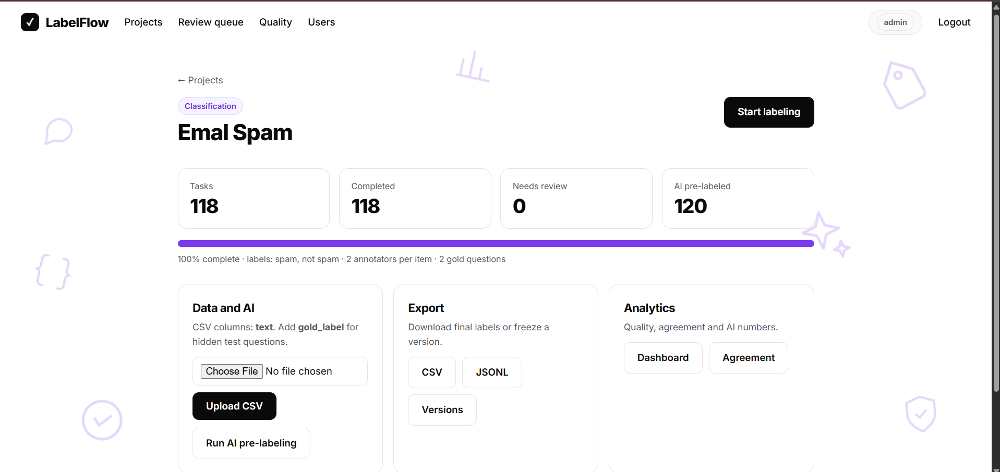 | 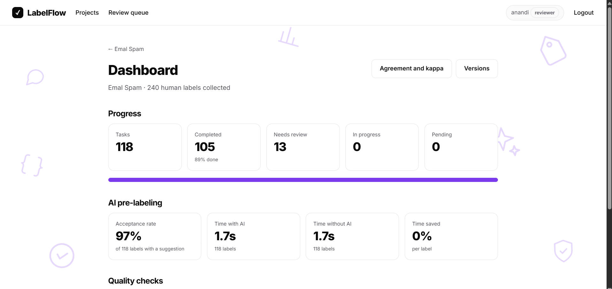 |

| Agreement and Cohen's kappa | Reviewer queue |
|---|---|
| 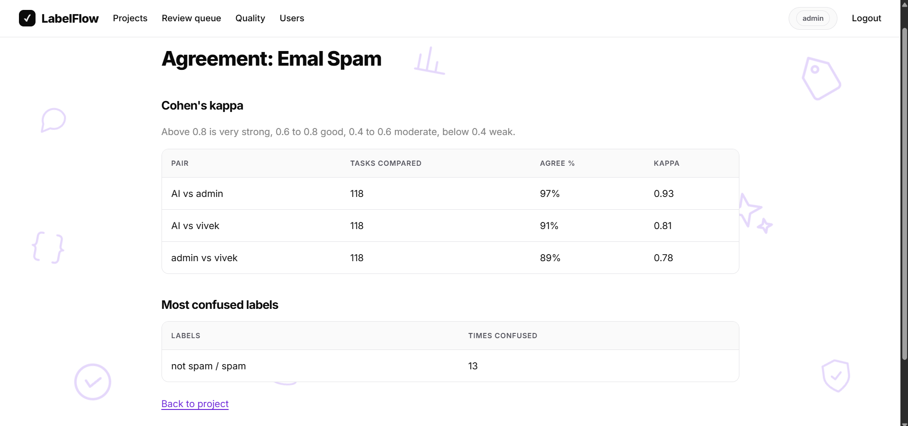 | 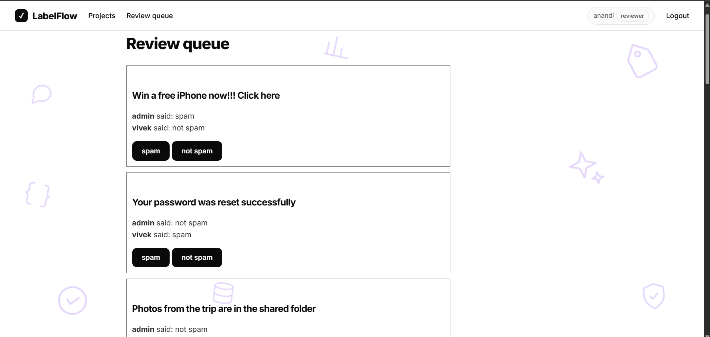 |

<details>
<summary>More screens</summary>

| | |
|---|---|
| 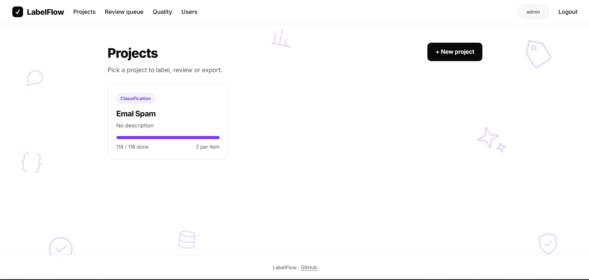 | 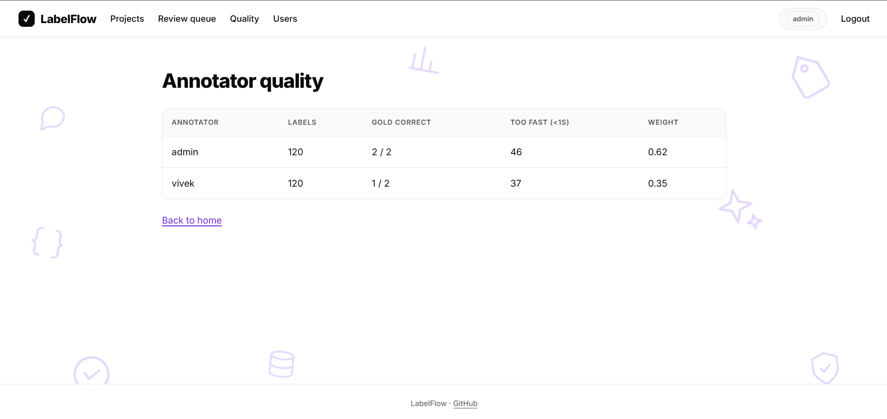 |
| 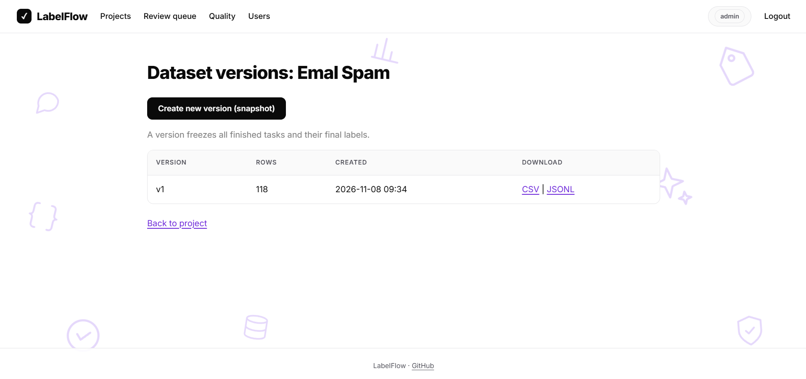 | 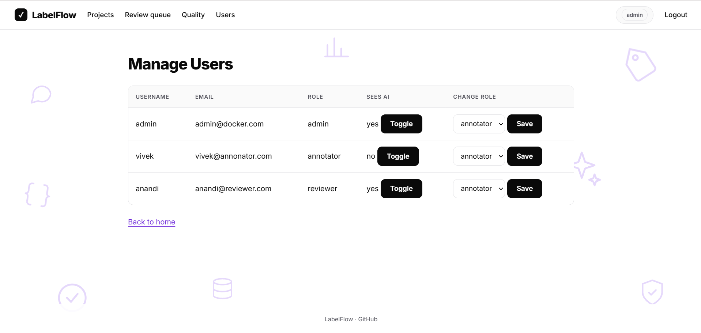 |
| 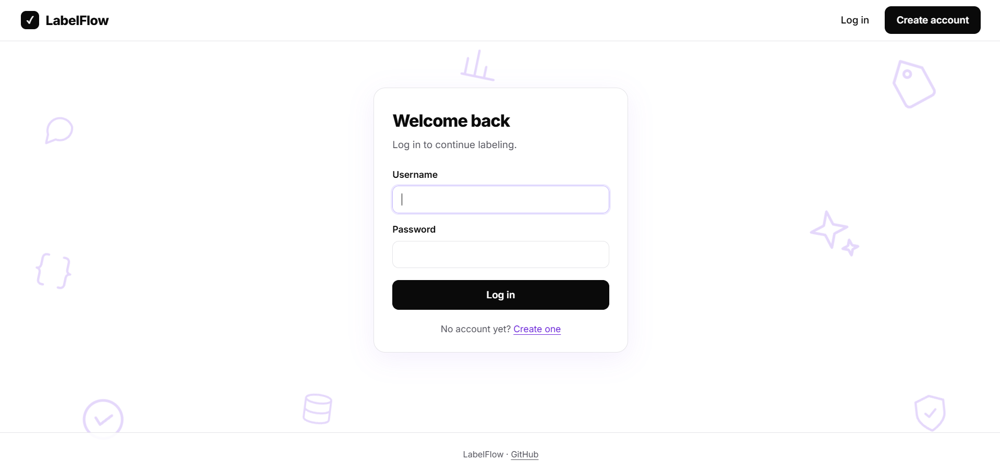 | 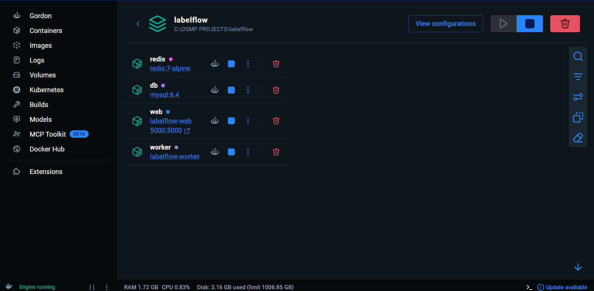 |

</details>

## Features

**Annotation workflow**
- Roles (admin, annotator, reviewer) enforced on every route
- Projects with label options, guidelines and 2 or 3 annotators per item
- CSV upload with validation, extra columns kept as metadata
- One-item-at-a-time labeling screen with keyboard shortcuts and per-label timing
- Review queue where the reviewer's decision is final
- CSV and JSONL export, and frozen dataset versions

**LLM and quality**
- LLM pre-labeling (Groq) in a background worker, stored separately from human labels
- Acceptance tracking: every human label records whether it matched the AI suggestion
- AI suggestion switch per annotator, for a fair with-AI vs without-AI timing comparison
- Hidden gold questions that score annotators but never enter consensus or exports
- Speed check: labels under one second are flagged
- Annotator weight from gold accuracy and the speed flag
- Cohen's kappa for every annotator pair and for the AI against each annotator, plus the most confused label pairs
- Pairwise A/B and 1 to 5 rating projects for LLM evaluation

## How it works

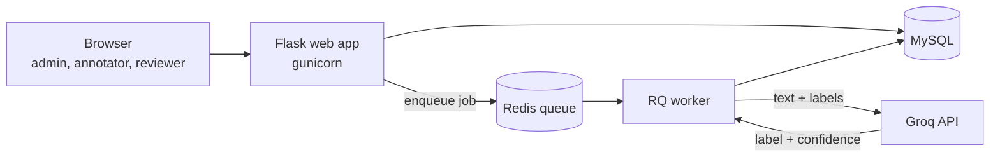

The web app never waits for the LLM. It puts a job on a Redis queue and returns at once. A separate worker calls Groq (with retries) and writes the predictions to MySQL. The web app and worker run the same code from the same Docker image.

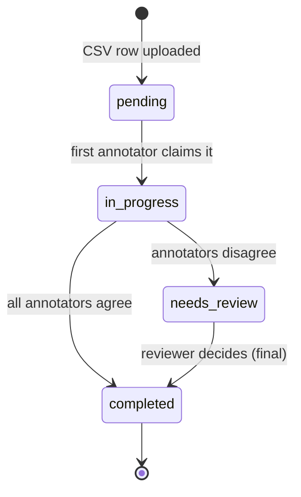

### Race-safe task assignment

Two people clicking "Start labeling" at the same moment must not break the rules. `claim_next_task()` uses three layers:

1. **Resume first:** a user with an unfinished task gets the same one back, so refreshing never grabs a second.
2. **Row lock:** the candidate task is locked with `SELECT ... FOR UPDATE`, the free slots are counted again inside the lock, and only then is the claim written.
3. **Database rule:** `UNIQUE (task_id, user_id)` makes it impossible for one person to hold a task twice, even if the application code has a bug.

### Quality scoring

- **Gold accuracy** = correct gold answers / gold answers seen.
- **Weight** = gold accuracy x (1 - share of labels under 1 second).
- **Cohen's kappa** is a pure function (`quality/agreement.py`) that takes two lists of labels and returns a number, so it can be tested without a database.

Full details, every route and a guide to each file: [`docs/ARCHITECTURE.md`](docs/ARCHITECTURE.md).

## Quick start (Docker)

You need [Docker Desktop](https://www.docker.com/products/docker-desktop/) and a free [Groq API key](https://console.groq.com).

**1. Clone**
```bash
git clone https://github.com/amit-0333/labelflow.git
cd labelflow
```

**2. Create a `.env` file** (copy `.env.example`)
```env
SECRET_KEY=change-this-to-a-long-random-text
GROQ_API_KEY=your_groq_key_here
GROQ_MODEL=openai/gpt-oss-20b
```

**3. Start everything**
```bash
docker compose up --build
```
This starts four containers: web app, background worker, MySQL and Redis.

**4. Open http://localhost:5000** and register. **The first account becomes the admin.** Promote a reviewer from the Users page.

**5. Try it**
1. Create a project and upload `sample_data/emails.csv`.
2. Click **Run AI pre-labeling**. In the logs you will see the worker finish with `Job OK`.
3. Click **Start labeling** and press `1` or `2`.

Stop with `docker compose down`. Data is kept in a Docker volume, and `docker compose down -v` wipes it. Running without Docker (WSL, Redis, worker) is covered in [`docs/RUN_GUIDE.md`](docs/RUN_GUIDE.md).

## CSV formats

| Project type | Required columns | Optional |
|---|---|---|
| Text classification | `text` | `gold_label`, any extra columns |
| Pairwise A/B | `prompt`, `answer_a`, `answer_b` | `gold_label` (`A` or `B`) |
| Rating 1 to 5 | `prompt`, `answer` | `gold_label` (`1` to `5`) |

A row with a `gold_label` becomes a hidden gold question.

## Results

### Demo run on sample data

Numbers read from the project dashboard after a demo run on a synthetic email-spam dataset, with two annotators and the AI.

| Measure | Value |
|---|---|
| Tasks | 118 |
| Human labels collected | 240 |
| Reached consensus | 105 (89%) |
| Sent to the reviewer (annotators disagreed) | 13 (11%) |
| AI suggestion accepted | 97% of 118 labels |
| Average time per label, with vs without AI | 1.7 s vs 1.7 s |

How to read these honestly:
- This was a **single-developer demo**. Some disagreements were created on purpose to exercise the review queue, so the 11% disagreement rate says nothing about real annotators.
- The 97% acceptance is on an easy, synthetic spam dataset.
- Labels were made with quick key presses and no reading, so the timing is the same with and without the AI. **No time saving can be claimed from this run.**

### Study with real annotators (in progress)

3 to 4 annotators label about 200 items. Half of them have the AI suggestion switched off, so the timing comparison is fair.

| Metric | How it is computed | Result |
|---|---|---|
| Cohen's kappa, human vs human | Agreement page | _pending_ |
| AI acceptance rate | Share of labels equal to the AI suggestion | _pending_ |
| Time per label, with vs without AI | Dashboard, per-annotator AI switch | _pending_ |
| Bad labels caught by quality checks | Wrong gold answers plus too-fast labels | _pending_ |

These cells will be filled with measured values, not estimates. Every formula, the protocol and the limitations of the study are in [`docs/EXPERIMENT.md`](docs/EXPERIMENT.md).

## Project structure

```
labelflow/
├── app.py                  Flask app factory, blueprints, /health
├── core/                   config, database, models
├── auth/                   login, register, roles, user management
├── projects/               projects, CSV upload and parsing
├── tasks/                  task assignment, labeling, review queue
├── quality/                annotator scores, kappa, dashboard stats
├── export/                 CSV/JSONL export, dataset versions
├── llm/                    Groq client (JSON output, retries)
├── jobs/                   Redis queue and the pre-labeling job
├── templates/  static/     pages and styles
├── sample_data/            example CSV files
├── docs/                   architecture, run guide, build story, screenshots
├── Dockerfile
└── docker-compose.yml
```

Each module has one job. `quality/agreement.py` knows nothing about Flask, and `llm/groq_client.py` exposes a single `prelabel(text, labels)` function that the background job calls.

**Stack:** Python, Flask, Flask-Login, Flask-SQLAlchemy, MySQL 8.4, Redis, RQ, Groq API, Jinja templates, plain CSS, gunicorn, Docker Compose.

## Documentation

| File | What you will find |
|---|---|
| [`docs/ARCHITECTURE.md`](docs/ARCHITECTURE.md) | Architecture, request flows, data model, every route, what each file does |
| [`docs/RUN_GUIDE.md`](docs/RUN_GUIDE.md) | Start and stop with Docker or in local mode, and a troubleshooting table |
| [`docs/DEVELOPMENT_JOURNEY.md`](docs/DEVELOPMENT_JOURNEY.md) | How it was built phase by phase, with the problems hit and fixed |
| [`docs/EXPERIMENT.md`](docs/EXPERIMENT.md) | How every metric is computed, the study protocol and its limitations |

## Known limitations

- Tables are created with `create_all()`. There are no migrations yet.
- No CSRF protection on forms yet, and `/perform_prelabel` is a GET route that changes state.
- The annotator weight is calculated and shown, but not yet used to weight votes in consensus.
- Kappa on rating tasks is unweighted, so a 4 vs a 5 counts as a full disagreement.
- Task claiming has been tested by hand with several users, but there is no automated concurrency stress test yet.
- There are no automated unit tests yet.
- The first registered user becomes admin, so register your own admin account right after deploying.

## Roadmap

- Complete the annotator study and publish the real numbers
- Unit tests for the pure functions (kappa, weight, CSV parsing) and a concurrency stress test
- Weighted voting using annotator scores, and weighted kappa for rating tasks
- Active learning: show the items the model is least sure about first
- Migrations and CSRF protection
- Free-tier deployment (Render, Aiven MySQL and Valkey)
- Connect to an LLM observability and eval platform, where LabelFlow supplies human labels to build eval datasets and calibrate LLM judges

## What I learned

- Concurrency belongs in the database: row locks and unique constraints are safer than checks in application code.
- Slow work such as LLM calls belongs in a background worker, with the same configuration as the web app.
- Hosted models get retired, so the model name is a setting and not a constant.
- Agreement numbers only mean something when the labeling conditions are controlled.

## License

MIT, see [`LICENSE`](LICENSE).