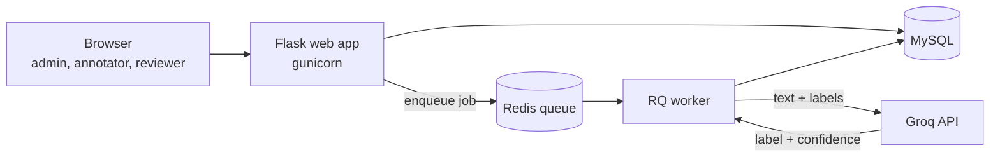
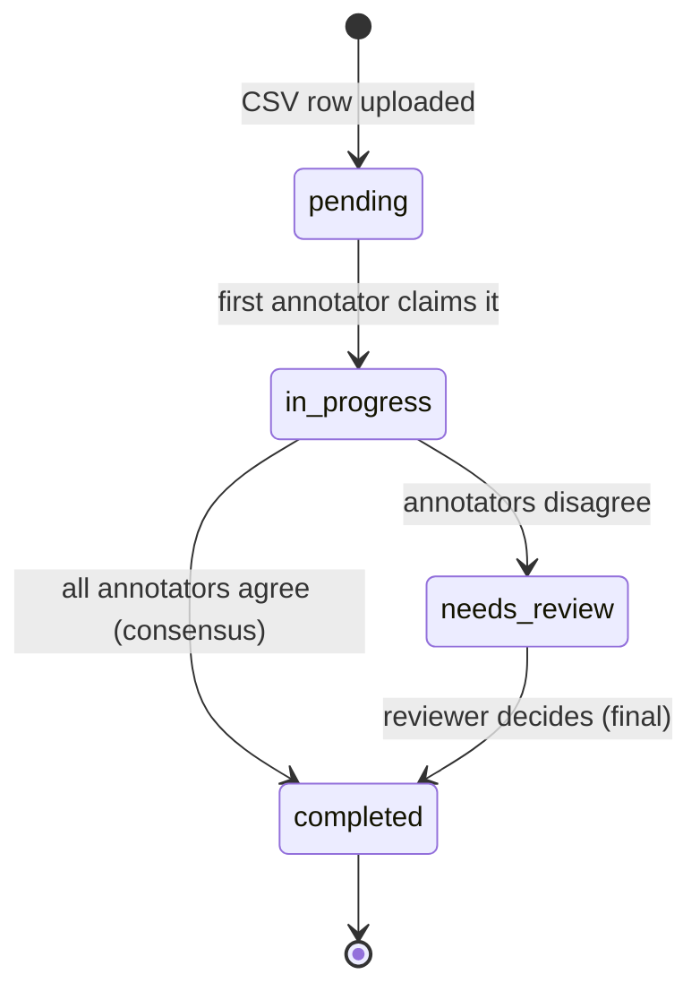

<div align="center">

# LabelFlow

**A data annotation platform with LLM pre-labeling and annotation quality analytics.**

Upload raw data, let a team label it at the same time, let an LLM suggest labels, and export a clean, versioned dataset together with numbers that tell you how much to trust it.


</div>


---

## Why this project exists

Every model learns from labeled examples, and bad labels quietly cap how good the model can get. Tools like Label Studio, Argilla and Prodigy exist because labeling is a team problem: many people, many opinions, and no easy way to tell whose labels to trust.

LabelFlow is a small, readable version of that idea. I built it to learn the backend side of ML work: safe concurrent access, background jobs, LLM integration, and the statistics of annotator agreement.

## What it does

1. An **admin** creates a project (labels, guidelines, how many annotators see each item) and uploads a CSV. Each row becomes a task.
2. A background worker sends every task to an **LLM (Groq)**, which returns a label and a confidence score. These are stored separately from human labels.
3. **Annotators** label one item at a time with keyboard shortcuts. Each item is shown to 2 or 3 different people, and the same task is never handed to the same person twice.
4. If annotators agree, the label is final. If they disagree, the task goes to a **reviewer** whose decision is final.
5. The platform measures quality: **Cohen's kappa**, AI acceptance rate, hidden **gold questions**, speed checks and per-annotator scores.
6. The final labels are exported as CSV or JSONL, or frozen as **dataset versions** (v1, v2, v3).

## Screenshots

| Labeling with AI suggestion | Pairwise A/B evaluation |
|---|---|
|  |  |

| Project overview | Dashboard |
|---|---|
|  |  |

| Agreement and Cohen's kappa | Reviewer queue |
|---|---|
|  |  |

<details>
<summary>More screens</summary>

| | |
|---|---|
|  |  |
|  |  |
|  |  |

</details>

## Features

### Core annotation workflow
- **Roles:** admin, annotator, reviewer, with role-based access on every route.
- **Projects** with label options, guidelines and 2 or 3 annotators per item.
- **CSV upload** with validation. Each row becomes a task, and extra columns are kept as metadata.
- **Labeling screen:** one item at a time, keyboard shortcuts (`1`, `2`, ...), per-label timing.
- **Safe task assignment:** no double-claiming, even with many people clicking at once.
- **Review queue:** disagreements go to a reviewer, and the reviewer's decision is final.
- **Export** the final dataset as CSV or JSONL.

### LLM and quality features
- **LLM pre-labeling** (Groq): a background worker returns a label and a confidence score for every task. AI labels and human labels live in separate tables so they can be compared later.
- **Acceptance tracking:** every human label records whether it matched the AI suggestion.
- **AI on/off per annotator**, so you can run a with-AI vs without-AI timing comparison.
- **Hidden gold questions:** tasks with a known answer are mixed in, shown without an AI hint, and used to score annotators. They never enter consensus or exports.
- **Speed checks:** labels made in under one second are flagged.
- **Annotator scores:** gold accuracy combined with the speed flag gives each annotator a weight from 0 to 1.
- **Agreement dashboard:** Cohen's kappa for every pair of annotators, and for the AI against each annotator, plus the most confused label pairs.
- **Dataset versioning:** freeze the current final labels as v1, v2, v3, and download any snapshot later.
- **LLM evaluation tasks:** pairwise "which answer is better, A or B?" and 1 to 5 rating projects, using the same review, export and agreement machinery.

## How it works



The web app never waits for the LLM. It puts a job on a Redis queue and returns immediately. A separate worker process pulls jobs, calls Groq (with retries), and writes the predictions to MySQL.

### Task lifecycle



### Safe task assignment

Two people clicking "Start labeling" at the same moment must not break the rules. `claim_next_task()` handles this in three layers:

1. **Resume first:** if a user already has an unfinished task, they get the same one back, so refreshing never grabs a second task.
2. **Row lock:** the candidate task is locked with `SELECT ... FOR UPDATE`, the slots are counted again inside the lock, and only then is the claim written. A second request waits for the first to commit and sees the updated count.
3. **Database rule:** a `UNIQUE (task_id, user_id)` constraint makes it impossible for one person to hold the same task twice, even if the application code has a bug.

### Quality scoring

- **Gold accuracy** = correct gold answers / gold answers seen.
- **Speed penalty** = share of labels under 1 second.
- **Weight** = gold accuracy x (1 - speed penalty), shown on the Quality page.
- **Cohen's kappa** is implemented as a pure function (`quality/agreement.py`) that takes two lists of labels and returns a number, so it can be tested without a database.

## Tech stack

| Layer | Technology |
|---|---|
| Backend | Python, Flask, Flask-Login, Flask-SQLAlchemy |
| Database | MySQL 8.4 |
| Background jobs | Redis, RQ |
| LLM | Groq API (model name is configurable) |
| Frontend | Server-rendered Jinja templates, plain CSS, a little JavaScript |
| Deployment | Docker, docker-compose, gunicorn |

## Quick start (Docker)

You need [Docker Desktop](https://www.docker.com/products/docker-desktop/) and a free [Groq API key](https://console.groq.com).

**1. Clone the repository**
```bash
git clone https://github.com/amit-0333/labelflow.git
cd labelflow
```

**2. Create a `.env` file** (copy `.env.example` and fill in your values)
```env
SECRET_KEY=change-this-to-a-long-random-text
GROQ_API_KEY=your_groq_key_here
GROQ_MODEL=openai/gpt-oss-20b
```

**3. Start everything**
```bash
docker compose up --build
```
This starts four containers: the web app, the background worker, MySQL and Redis.

**4. Open http://localhost:5000**

Register an account. **The first account created becomes the admin**, and later accounts are annotators. Promote a reviewer from the **Users** page.

**5. Try it**
1. Create a project, then upload `sample_data/emails.csv`.
2. Click **Run AI pre-labeling** and wait a few seconds.
3. Click **Start labeling** and press `1` or `2`.

Stop with `docker compose down`. Your data is kept in a Docker volume. Use `docker compose down -v` to wipe it.

> A step-by-step guide for running without Docker (WSL, Redis, worker) is in [`docs/RUN_GUIDE.md`](docs/RUN_GUIDE.md).

## CSV formats

| Project type | Required columns | Optional |
|---|---|---|
| Text classification | `text` | `gold_label`, any extra columns |
| Pairwise A/B | `prompt`, `answer_a`, `answer_b` | `gold_label` (`A` or `B`) |
| Rating 1 to 5 | `prompt`, `answer` | `gold_label` (`1` to `5`) |

A row with a `gold_label` becomes a hidden gold question.

## Project structure

```
labelflow/
├── app.py                  Flask app factory, blueprints, /health
├── core/                   config, database, models
├── auth/                   login, register, roles, user management
├── projects/               projects, CSV upload and parsing
├── tasks/                  task assignment, labeling, review queue
├── quality/                annotator scores, kappa, dashboard stats
├── export/                 CSV/JSONL export, dataset versions
├── llm/                    Groq client (JSON output, retries)
├── jobs/                   Redis queue and the pre-labeling job
├── templates/  static/     pages and styles
├── sample_data/            example CSV files
├── docs/                   architecture, run guide, development journey
├── Dockerfile
└── docker-compose.yml
```

Each module has one job and exposes small functions. For example, `quality/agreement.py` knows nothing about Flask, and `llm/groq_client.py` exposes a single `prelabel(text, labels)` function that the background job calls.

## Database

Eight tables: `users`, `projects`, `tasks`, `assignments`, `annotations`, `ai_predictions`, `review_decisions` and `dataset_versions`. Human labels (`annotations`) and AI labels (`ai_predictions`) are deliberately separate so the two can be compared.

## Evaluation

The platform computes these numbers. The study below measures them on real annotators.

| Metric | How it is computed | Result |
|---|---|---|
| Cohen's kappa (human vs human) | Agreement page | _pending study_ |
| AI acceptance rate | Share of labels equal to the AI suggestion | _pending study_ |
| Time per label with vs without AI | Dashboard, using the per-annotator AI switch | _pending study_ |
| Bad labels caught by quality checks | Wrong gold answers plus too-fast labels | _pending study_ |

**Study plan:** 3 to 4 annotators label about 200 items. Half of them have the AI suggestion switched off, so the time comparison is fair.

The screenshots in this README come from a quick demo run on sample data with fast key presses, so they are not evidence of real-world accuracy or time savings.

## Known limitations

- Tables are created with `create_all()`. There are no migrations yet.
- There is no CSRF protection on forms yet.
- The annotator weight is calculated and displayed, but it is not yet used to weight votes in the consensus step.
- Kappa on rating tasks is unweighted, so a 4 vs a 5 counts as a full disagreement.
- The race-safe claiming logic has been tested by hand with several users, but there is no automated concurrency stress test yet.
- The first registered user becomes admin, so register your own admin account right after deploying.

## Roadmap

- Weighted voting using annotator scores
- Weighted kappa for rating tasks
- Active learning: show the items the model is least sure about first
- Concurrency stress test (many simulated annotators at once)
- Database migrations and CSRF protection
- Connect to an LLM observability and eval platform: LabelFlow supplies human labels to build eval datasets and calibrate LLM judges

## More documentation

- [`docs/ARCHITECTURE.md`](docs/ARCHITECTURE.md): architecture, workflow and what each file does
- [`docs/RUN_GUIDE.md`](docs/RUN_GUIDE.md): how to start and stop everything
- [`docs/DEVELOPMENT_JOURNEY.md`](docs/DEVELOPMENT_JOURNEY.md): how it was built, phase by phase, and the problems solved along the way

## What I learned

- Concurrency lives in the database: row locks and unique constraints are safer than checks in application code.
- Slow work (LLM calls) belongs in a background worker, and the worker needs the same configuration as the web app.
- Free LLM models get retired, so the model name is a setting, not a constant.
- Agreement metrics only mean something when the labeling conditions are controlled.

## License

MIT. See `LICENSE` once added.