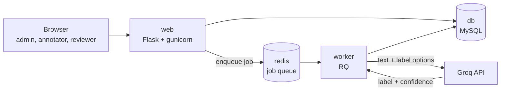
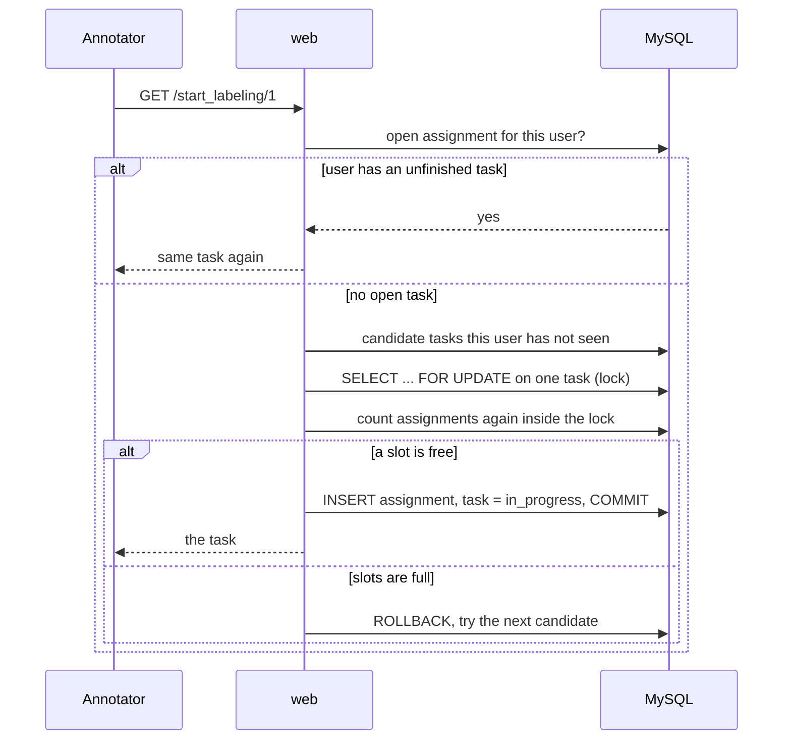
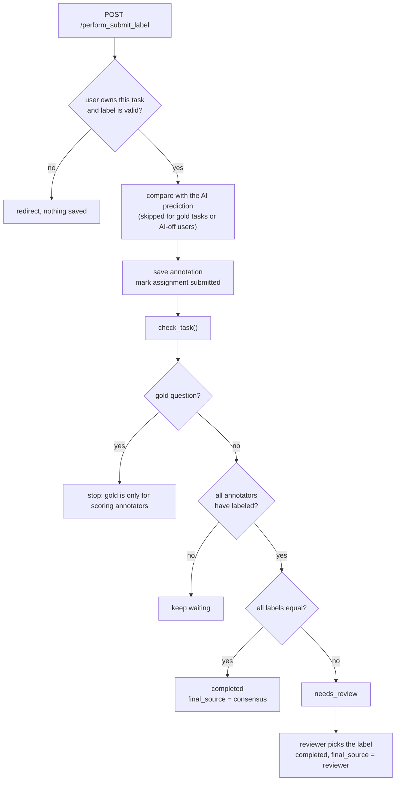
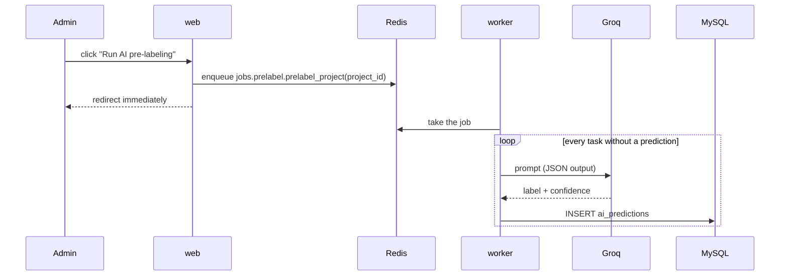
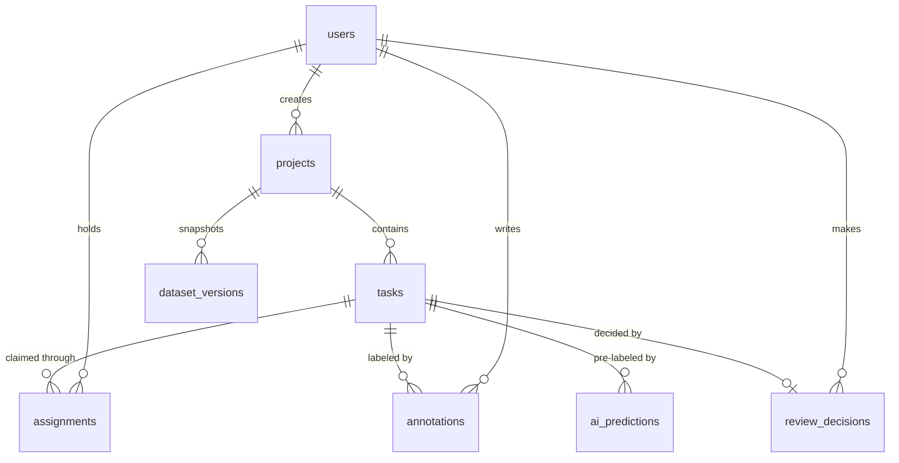

# Architecture

How LabelFlow is put together, how data flows through it, and what every file does.

## 1. System overview

| Component | What it does |
|---|---|
| **web** | Serves all pages, handles login and roles, assigns tasks, saves labels. Never waits for the LLM. |
| **worker** | Pulls jobs from Redis and calls Groq. Writes the predictions to MySQL. |
| **db** | MySQL: the single source of truth for users, tasks, labels, versions. |
| **redis** | The job queue between web and worker. |
| **Groq** | The external LLM that suggests a label and a confidence score. |

The web app and the worker run **the same code** from the same image. Only the start command differs (`gunicorn` vs `rq worker`).

## 2. Request flows

### 2.1 Claiming a task (safe concurrency)

Three layers keep this safe: resuming the open task, the row lock with a recount, and a `UNIQUE (task_id, user_id)` constraint as the final guard.

### 2.2 Submitting a label and reaching consensus

### 2.3 AI pre-labeling

The Groq client validates the returned label against the project's options and retries up to three times with a growing delay. Tasks that already have a prediction are skipped, so running the job again is safe.

### 2.4 Export and versions

- `/export/<project>/csv|jsonl` builds the file from the **current** final labels of completed, non-gold tasks.
- `/perform_create_version/<project>` copies those rows into `dataset_versions.data` as JSON. A version never changes afterwards, even if labels change later.

## 3. Data model

| Table | Key columns | Notes |
|---|---|---|
| `users` | username, email, password_hash, role, see_ai | `role` is admin, annotator or reviewer. `see_ai` switches the AI suggestion on or off for that person. |
| `projects` | name, guidelines, label_options (JSON), task_type, annotators_per_item | `task_type`: classification, pairwise or rating. |
| `tasks` | project_id, text, extra_data (JSON), status, is_gold, gold_label, final_label, final_source | `status`: pending, in_progress, needs_review, completed. |
| `assignments` | task_id, user_id, status | `UNIQUE (task_id, user_id)`. Status: assigned or submitted. |
| `annotations` | task_id, user_id, label, time_taken_ms, accepted_ai | Human labels only. `UNIQUE (task_id, user_id)`. `accepted_ai` is empty when no suggestion was shown. |
| `ai_predictions` | task_id, model_name, label, confidence | AI labels only, kept apart on purpose. |
| `review_decisions` | task_id (unique), reviewer_id, label | The reviewer's final word. |
| `dataset_versions` | project_id, version_number, row_count, data (JSON) | Frozen snapshots. `UNIQUE (project_id, version_number)`. |

## 4. Routes

| Area | Routes | Access |
|---|---|---|
| App | `GET /`, `GET /health` | public |
| Auth | `/register`, `/perform_registration`, `/login`, `/perform_login`, `/logout` | public |
| Users | `/admin/users`, `/perform_role_change`, `/perform_toggle_ai/<id>` | admin |
| Projects | `/projects`, `/project/<id>` | all logged-in roles |
| Projects | `/create_project`, `/perform_create_project`, `/perform_upload_csv/<id>`, `/perform_prelabel/<id>` | admin |
| Labeling | `/start_labeling/<project_id>`, `/perform_submit_label` | admin, annotator |
| Review | `/review`, `/perform_review` | admin, reviewer |
| Analytics | `/dashboard/<id>`, `/agreement/<id>` | admin, reviewer |
| Analytics | `/quality` | admin |
| Export | `/export/<id>/<csv|jsonl>`, `/versions/<id>`, `/perform_create_version/<id>`, `/export_version/<version_id>/<csv|jsonl>` | admin, reviewer |

Access is enforced by the `@role_required(...)` decorator in `auth/decorators.py`, not only by hiding links.

## 5. File guide

### Root

| File | What it does |
|---|---|
| `app.py` | App factory. Loads config, connects the database and login manager, registers all blueprints, creates tables, exposes `/` and `/health`. |
| `requirements.txt` | The ten packages the app needs. |
| `Dockerfile` | Builds the single image used by both `web` and `worker`. Starts gunicorn with `--preload`. |
| `docker-compose.yml` | Defines the four services, their health checks and the database volume. |
| `.dockerignore` | Keeps the virtual environment, git data and `.env` out of the image. |
| `.env.example` | Names of all settings with fake values. Copy to `.env`. |
| `.gitignore` | Keeps secrets and caches out of git. |
| `Procfile` | One line for hosts that start the app from a Procfile (`gunicorn app:app`). |

### `core/`

| File | What it does |
|---|---|
| `config.py` | Reads settings from the environment. Builds the database URL from `DATABASE_URL` or from the `DB_*` parts. Holds Redis and Groq settings, upload size limit and cookie settings. |
| `db.py` | The shared SQLAlchemy object. |
| `models.py` | All eight tables. |

### `auth/`

| File | What it does |
|---|---|
| `routes.py` | Register, login, logout, the admin user list, role changes and the AI on/off toggle. |
| `decorators.py` | `role_required(...)`: requires login and one of the given roles, else 403. |

### `projects/`

| File | What it does |
|---|---|
| `routes.py` | Project list and page, project creation, CSV upload, and the button that queues the AI job. Also computes the counts shown on cards and the project page. |
| `csv_parser.py` | Pure function: validates a CSV for the project type and returns tasks or an error message. Reads the optional `gold_label` column. |

### `tasks/`

| File | What it does |
|---|---|
| `assignment.py` | `claim_next_task()`: resume, optional gold question, then lock-and-claim. Contains the `GOLD_CHANCE` setting. |
| `review.py` | `check_task()`: decides completed, needs_review or keep waiting. Ignores gold questions and reviewer-decided tasks. |
| `routes.py` | The labeling screen, label submission (including the AI acceptance flag), the review queue and the reviewer decision. |

### `quality/`

| File | What it does |
|---|---|
| `scores.py` | Per-annotator gold accuracy, too-fast labels and weight. `calc_weight()` is a pure function. |
| `agreement.py` | `cohens_kappa()` (pure function) and the pairwise agreement and confusion table, including AI vs each annotator. |
| `stats.py` | Numbers for the dashboard: progress, acceptance rate, time with vs without AI, quality counts. |
| `routes.py` | The `/quality`, `/agreement/<id>` and `/dashboard/<id>` pages. |

### `export/`

| File | What it does |
|---|---|
| `exporter.py` | Pure functions: rows in, CSV or JSONL text out. |
| `routes.py` | Downloads, dataset version snapshots and version downloads. |

### `llm/`

| File | What it does |
|---|---|
| `groq_client.py` | `prelabel(text, labels)`: asks Groq for JSON, validates the label, clamps the confidence, retries three times with a growing delay. Returns `None` if it keeps failing. |

### `jobs/`

| File | What it does |
|---|---|
| `queue.py` | The Redis connection and the default RQ queue. |
| `prelabel.py` | The background job: labels every task without a prediction, one commit per task, with a short pause for rate limits. Also builds the right prompt for classification, pairwise and rating tasks. |
| `tasks.py` | A small sample job used to prove the queue works. |

### `templates/` and `static/`

| File | What it does |
|---|---|
| `base.html` | Shared layout: top bar, background icons, footer, and the script that sets progress bar widths. |
| `_icons.html` | The floating translucent icons. |
| `home.html`, `login.html`, `register.html` | Landing page and the account pages. |
| `projects.html`, `create_project.html`, `project.html` | Project cards, creation form, project overview with action cards. |
| `task.html` | The labeling screen. Adapts to classification, pairwise and rating, shows the AI chip and handles keyboard shortcuts and timing. |
| `review.html` | The reviewer queue. |
| `dashboard.html`, `agreement.html`, `quality.html` | Analytics pages. |
| `versions.html` | Dataset snapshots. |
| `manage_users.html` | Role changes and the AI toggle. |
| `static/style.css` | The whole visual design. |

### Other folders

| Path | What it does |
|---|---|
| `sample_data/` | Example CSV files to try the app. |
| `docs/` | This documentation and the screenshots. |

## 6. Configuration

| Setting | Purpose |
|---|---|
| `SECRET_KEY` | Signs login cookies. Must be a real value in production. |
| `APP_ENV` | `production` turns on secure cookies and refuses the default secret key. |
| `DATABASE_URL` | Full database address. Overrides the `DB_*` settings when set. |
| `DB_USER`, `DB_PASSWORD`, `DB_HOST`, `DB_PORT`, `DB_NAME` | Used to build the address when `DATABASE_URL` is not set. |
| `REDIS_URL` | The queue address. |
| `GROQ_API_KEY` | Groq credentials. |
| `GROQ_MODEL` | Model name. Kept in config because hosted models get retired. |
| `PORT` | Port for `python app.py`. |

In Docker, `docker-compose.yml` sets `DATABASE_URL` and `REDIS_URL` to the container names (`db`, `redis`).

## 7. Design decisions

- **Separate AI and human labels** so agreement between them can be measured.
- **Constraints in the database**, not only in code, for anything that must never happen twice.
- **Pure functions for the math** (`cohens_kappa`, `calc_weight`, CSV parsing, export). They know nothing about Flask or MySQL, so they can be tested alone.
- **Slow work in a worker.** The web request returns immediately and the worker can retry.
- **One image, two commands.** The worker always has exactly the same code as the web app.
- **Gold questions are invisible to consensus.** They score people and never become dataset rows.
- **Settings in the environment**, so deployment changes values and not code.

## 8. Known design debt

- No migrations (`create_all()` only creates missing tables).
- No CSRF tokens, and `/perform_prelabel` is a GET route that changes state.
- Annotator weight is computed but not yet used for weighted voting.
- Rating tasks use unweighted kappa.
- Task claiming is tested by hand with several users, not yet by an automated stress test.